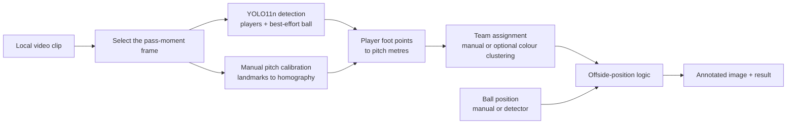

# AI Offside Line Detector

A lightweight, **CPU-first** tool that estimates **offside positions** in a single football video
frame. You pick the pass-moment frame, calibrate the pitch by marking known pitch landmarks, and the
tool detects the players, projects their feet onto a top-down pitch model, and draws the offside
line on an annotated image.

> **Experimental project. Not an official VAR or referee system.**
> It estimates offside *position* from one camera angle. It does **not** judge whether a player is
> involved in play, so it does not decide an offside *offence*, and it makes no claim of
> VAR-grade accuracy. Results depend heavily on how carefully you calibrate the pitch.

It was built as an academic/portfolio computer-vision project: pretrained detection (YOLO11n),
projective geometry (homography with OpenCV), explicit football-rule logic, and a Streamlit UI, all
designed to run on an ordinary laptop with no GPU.

## Screenshots

> **Placeholders.** Screenshots have not been added yet. Capture them from your own clips and save
> them in [`docs/images/`](docs/images/), then replace the rows below with image links.
> Only publish screenshots of footage you have the right to share. Do **not** commit frames from
> broadcast footage.

| Placeholder | What to capture |
|---|---|
| `docs/images/calibration.png` | The calibration step: numbered landmarks on a frame and the magenta pitch-line overlay. |
| `docs/images/result.png` | An annotated result: cyan/blue player boxes, the red offside line, the status banner. |
| `docs/images/app-overview.png` | The full Streamlit page, including the attacking-direction diagram in the sidebar. |

## Features

- **Player detection** — pretrained YOLO11n on CPU (Ultralytics). Players come from the COCO
  `person` class; each player's **foot point** (bottom-centre of the box) is what gets projected.
- **Pitch calibration** — click known pitch landmarks and pair each with its real position in
  metres. Choose from 31 predefined landmarks (corners, halfway line, centre circle, penalty and
  goal areas, penalty marks) or enter a custom point. A homography is estimated with OpenCV, with
  validation (at least 4 points, not collinear, reasonably spread), outlier rejection, warnings,
  per-landmark residuals and a visual overlay check.
- **Offside geometry** — the offside line is the **more goalward of the second-last opponent and the
  ball**. Level is onside, a player in their own half cannot be offside, and the goalkeeper is not
  special-cased. Without a ball position, or with fewer than two defenders, the result is
  `INSUFFICIENT_DATA` rather than a guess.
- **Team assignment** — manual assignment is the reliable path. Optional jersey-colour clustering is
  available as a best-effort convenience and never decides which side attacks.
- **Annotation** — an annotated image with team-coloured boxes, player ids, foot points, the ball and
  its source, per-attacker ONSIDE/OFFSIDE marks, and the offside line (drawn only for a confident
  result).
- **Streamlit UI** — upload a clip, choose a frame, detect players, calibrate by clicking, assign
  teams, place the ball, run, and download the annotated PNG.
- **Command-line option** — the same pipeline from a JSON config (`scripts/run_pipeline.py`).

## How it works



Pitch coordinates are in **metres**: **X** runs along the length (0 to 105 m by default) and **Y**
across the width (0 to 68 m). The analysis covers **one selected frame**. There is no player
tracking, and player ids (`p0`, `p1`, ...) are valid for that frame only.

| Module | Responsibility |
|---|---|
| `src/offside/video_io.py` | Open clips safely, read metadata, read a single frame, resize |
| `src/offside/detection.py` | YOLO11n wrapper with typed results (no Ultralytics types leak out) |
| `src/offside/calibration.py` | Landmark pairs to a validated homography |
| `src/offside/pitch_model.py` | Landmark catalogue and pitch-marking geometry |
| `src/offside/geometry.py` | Image to pitch and pitch to image transforms |
| `src/offside/offside.py` | The offside-position rules (pure, no CV imports) |
| `src/offside/team_cluster.py` | Manual team assignment, optional colour clustering |
| `src/offside/annotate.py` | Drawing: boxes, labels, offside line, calibration overlay |
| `src/offside/pipeline.py` | Single-frame end-to-end orchestration |
| `app/streamlit_app.py`, `app/offside_ui.py` | The web UI and its testable helpers |

## Technology stack

| Area | Tools |
|---|---|
| Language | Python 3.13 |
| Detection | Ultralytics YOLO11n, PyTorch (CPU build) |
| Vision and geometry | OpenCV, NumPy |
| UI | Streamlit, streamlit-image-coordinates |
| Config | PyYAML |
| Testing | pytest (including Streamlit's `AppTest` for the UI script) |

## Hardware and CPU requirements

- **No GPU needed.** Everything runs on the CPU. Install the CPU build of PyTorch (see below).
- Developed and tested on a Dell Inspiron 15 5000 (11th-gen Intel CPU, 8 GB RAM, Intel Iris Xe
  graphics, no NVIDIA GPU) running Windows. Minimum requirements have not been measured formally.
- The Intel integrated GPU is **not** used by this PyTorch build.
- Detection is not real-time. On the test laptop, the first detection on a 1080×810 frame took about
  2.4 s and a later full pipeline run about 0.36 s. These are single measurements, not a benchmark.
- Use short clips (a few seconds to about 15 s). The app reads one frame at a time and never loads a
  whole video into memory.

## Installation (Windows, PowerShell)

Developed and tested on **Python 3.13.7**. `pyproject.toml` allows Python 3.11 and newer, but other
versions have not been tested.

```powershell
# 1. Get the code and enter the folder
git clone <repository-url>
cd ai-offside-line-detector

# 2. Create and activate a virtual environment
py -3.13 -m venv .venv
.\.venv\Scripts\Activate.ps1          # if blocked: Set-ExecutionPolicy -Scope Process Bypass
python -m pip install --upgrade pip

# 3. Install CPU-only PyTorch FIRST, so a CUDA build is never pulled in
pip install torch torchvision --index-url https://download.pytorch.org/whl/cpu

# 4. Install the project dependencies
pip install -r requirements.txt
```

Tested versions (also pinned in `requirements.txt`): `torch 2.15.0+cpu`, `torchvision 0.29.2+cpu`,
`ultralytics 8.4.201`, `opencv-python 5.0.0.93`, `numpy 2.5.4`, `PyYAML 6.0.3`, `streamlit 1.66.1`,
`streamlit-image-coordinates 0.4.1`.

## Download the model weights

Weights are **not** stored in this repository. Download them once (internet needed):

```powershell
python scripts/fetch_models.py
```

This saves `yolo11n.pt` (about 5.4 MB) to `models/`. The app warns you in the sidebar if it is
missing. Ultralytics may also leave a copy in the folder you ran the command from; Git ignores it
and you can delete it.

## Run the Streamlit app

```powershell
streamlit run app/streamlit_app.py
```

Then open the address Streamlit prints (usually <http://localhost:8501>).

1. **Upload** a short clip (`.mp4`, `.mov`, `.avi`, `.mkv`) and **select the pass-moment frame**.
2. **Detect players**. Ids such as `p0`, `p1` apply to this frame only.
3. **Calibrate the pitch** (see below).
4. **Assign each player** to Attacking or Defending.
5. **Place the ball** by clicking it. A manual ball is authoritative. Without a ball there is no
   verdict.
6. **Run analysis**, review the explanation and per-player results, and **download** the PNG.

Changing the frame, landmarks, pitch size, teams, ball or direction discards a stale result, so the
verdict on screen always matches the current inputs.

### Calibrating the pitch

- Click a point in the image, then say which pitch landmark it is (or enter a custom point in
  metres).
- Use **any** landmarks visible in the frame. You need **at least 4**, not all on one line, and
  spread across the pitch. Every click must be the exact physical point the name describes.
- "X=0 end" / "X=L end" are the two goal lines and "Y=0 side" / "Y=W side" the two touchlines.
  These are **pitch** coordinates, not image left/right. Pick which end is X=0 and stay consistent,
  and set the attacking direction on the same axis (the sidebar diagram highlights the goal being
  attacked).
- A low reprojection error only means your landmarks agree with each other. **It does not prove the
  calibration is accurate.** With exactly 4 points the error is about zero by construction. Check the
  magenta overlay: the projected pitch lines should sit on the real lines.
- A calibration belongs to the frame and pitch size it was built on. A different frame, or a change
  of pitch dimensions, requires recalibrating, because the app cannot tell whether the camera moved.

<details>
<summary>Command-line usage</summary>

```powershell
# First run without a "teams" mapping to list the detected player ids for the frame:
python scripts/run_pipeline.py --config analysis.json --output outputs/frame.png
```

`analysis.json` (image coordinates in pixels, pitch coordinates in metres):

```json
{
  "video": "data/raw/clip.mp4",
  "frame_index": 120,
  "attacking_direction": "positive_x",
  "pitch": {"length": 105.0, "width": 68.0},
  "calibration": {
    "image_points": [[100,700],[1180,700],[980,300],[300,300]],
    "pitch_points": [[0,0],[105,0],[105,68],[0,68]]
  },
  "teams": {"p0": "defending", "p1": "defending", "p2": "attacking"},
  "ball_image_xy": [640, 650]
}
```

Use `"timestamp_seconds"` instead of `"frame_index"` to select by time. `scripts/test_detection.py`
runs detection on sampled frames of a clip.

</details>

## Run the tests

```powershell
pip install -r requirements-dev.txt
pytest
```

The suite needs no model weights, internet or GPU. It includes tests that execute the real Streamlit
script in-process (no browser), so a full run takes roughly 10 to 20 seconds. The click-to-place
behaviour of the image component in a real browser is checked by hand, not by the tests.

## Known limitations

- **One frame only.** No player tracking, no whole-video verdict, no automatic pass-moment
  detection, no annotated video output.
- **Offside position, not offence.** Active involvement in play is not judged.
- **Single camera.** Lens distortion, calibration error and occlusion all affect the result. The
  tool has **not** been evaluated on real footage, and no accuracy figure is claimed.
- **Calibration is manual** and only as good as your landmark clicks. Camera movement, zoom or a cut
  makes it invalid.
- **Ball detection is unreliable** (COCO "sports ball" is not a football detector), so a manual ball
  position is the dependable route. Without a ball the result is `INSUFFICIENT_DATA`.
- **Ground contact is estimated** from the bottom-centre of each bounding box, which can differ from
  the real foot position, especially for occluded or jumping players.
- **Team colour clustering** is best-effort and does not reliably handle referees, goalkeepers,
  similar kits or changing light.
- **CPU only**, so processing is slow compared with GPU setups.

## Future improvements

- Pose-based ground-contact estimation, adopted only if it measurably beats the bounding-box foot
  point on CPU.
- CPU optimisation (for example OpenVINO) if profiling shows it is worthwhile.
- Multi-frame analysis: player tracking and annotated video. Multi-frame calibration would need a
  reliable check that the camera is static (see `SPEC.md` section 13).
- Automatic ball and pass-moment suggestions, and semi-automatic pitch-line detection.
- Evaluation against clips with known ground truth.

## Footage and data

No football footage is included and nothing is downloaded automatically. Bring your own clips and
make sure you have the right to use them. See [`data/README.md`](data/README.md). Clips, model
weights and generated outputs are excluded from Git.

## Project documentation

[`SPEC.md`](SPEC.md) (original design), [`PROJECT_CONTEXT.md`](PROJECT_CONTEXT.md) (architecture and
rules), [`DECISIONS.md`](DECISIONS.md) (design decisions), [`PROGRESS.md`](PROGRESS.md) (milestones
and test results).

## License

No license has been chosen for this repository yet, so by default all rights are reserved. Add a
`LICENSE` file before others reuse the code. Note that the project depends on
[Ultralytics](https://github.com/ultralytics/ultralytics) (AGPL-3.0), and Ultralytics distributes
the YOLO11 weights under AGPL-3.0 or a commercial license. Check their terms before redistributing
or building on this project.

## Acknowledgements

[Ultralytics YOLO11](https://github.com/ultralytics/ultralytics), [OpenCV](https://opencv.org/),
[PyTorch](https://pytorch.org/), [Streamlit](https://streamlit.io/) and
[streamlit-image-coordinates](https://github.com/blackary/streamlit-image-coordinates).
